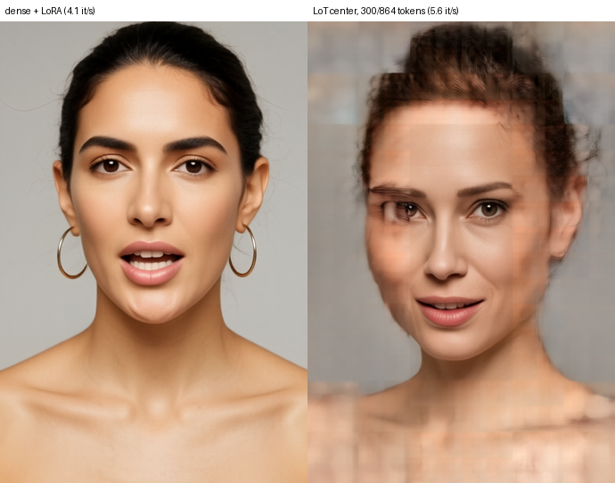
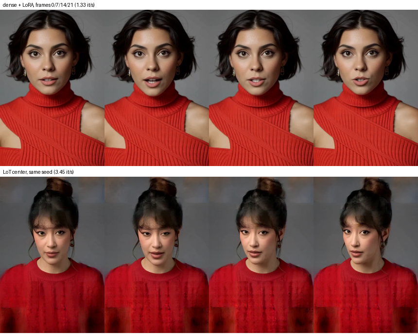
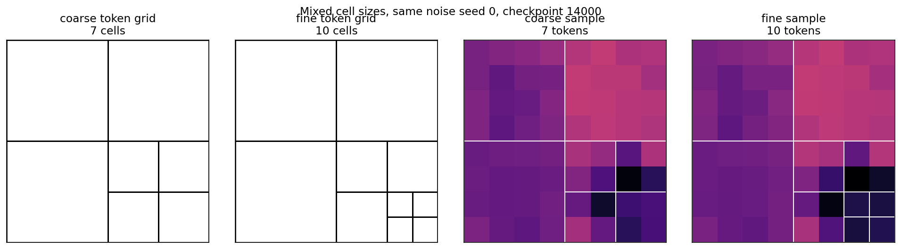
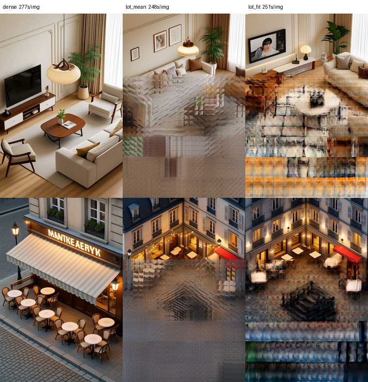

# ComfyUI MiniMax H3 Image Lane (T=1)

T=1 still nodes for MiniMax H3. **Does not patch** stock
`comfy_extras/nodes_minimax_h3.py`. Video Ref2VA stays on the 17k+5 grid
(`length` 5, 22, 124…).

Based on the Comfy T=1 recipe in
[Mamad8/MiniMax-H3-Image-VAE#4](https://huggingface.co/Mamad8/MiniMax-H3-Image-VAE/discussions/4)
and the `align_frame_count(1) → 1` helpers from
[discussion #1](https://huggingface.co/Mamad8/MiniMax-H3-Image-VAE/discussions/1).
Those threads patch core Comfy. This pack is a **sidecar**: new node ids,
stock nodes untouched.

| Lane | Nodes | VAE | Length |
|---|---|---|---|
| **Video** (stock) | Empty MiniMax H3 AV Latent, Reference to Video | `minimax_h3_video_vae_fp16` | 5, 22, 124… |
| **Image** (this pack) | Empty MiniMax H3 Image Latent, Reference to Image, Image to Image, LoT Apply / Unscale | [`minimax_h3_t1_image_vae_step1597`](https://huggingface.co/Mamad8/MiniMax-H3-Image-VAE) | always 1 |

## Install

```bash
cd ComfyUI/custom_nodes
git clone https://github.com/scrya-com/ComfyUI-MiniMax-H3-Image-Lane.git
```

Restart Comfy. Search the menu for **`minimax-image`**.

Load `workflows/t1_ref2va_image.json` (or drag it onto the canvas).

## Weights (not in this repo)

| File | Role |
|---|---|
| [minimax_h3_t1_image_vae_step1597.safetensors](https://huggingface.co/Mamad8/MiniMax-H3-Image-VAE) | visual encode **and** decode |
| [minimax_h3_audio_vae_fp32.safetensors](https://huggingface.co/Comfy-Org/MiniMax-H3) | audio VAE (Ref2VA still wants it) |
| MiniMax H3 DiT (hybrid ref2va or official) | sampler |
| Qwen3-VL MiniMax CLIP | text / refs |

Use the **Image VAE** on both the Reference-to-Image `vae` input and **VAE Decode**.
The frozen encoder matches the video VAE (`||z_image − z_video|| = 0`). Only the
decoder is image-tuned. Video VAE at T=1 is the fringe / line path (~0.11 pixel
L1 vs ~0.006).

## Nodes

- **Empty MiniMax H3 Image Latent (T=1)** — `z` shape `[B, 24, 1, H/16, W/16]`
- **MiniMax H3 Reference to Image (T=1)** — ref2va, `length` locked to 1
- **MiniMax H3 Image to Image (T=1)** — t2va / first-frame, `length` locked to 1

Each execute temporarily swaps `temporal_shape` on the stock module, then
restores it. Video graphs keep snapping `length=1` → 5 frames / T′=2.

## Level-of-Token (LoT) for stills and video — research

Code, training and timing: **[scrya-com/lot-diffusion](https://github.com/scrya-com/lot-diffusion)**.

> [!WARNING]
> **⚠️ THIS MODEL NEEDS MORE TRAINING — HELP WANTED.** LoT output is still visibly softer than dense H3 (blocking at the edges, smeared hair). The pipeline works; the weights need more training. Join in: **[the help-wanted discussion](https://github.com/scrya-com/lot-diffusion/discussions/1)**.



768×1152 still, same seed. Dense + LoRA at 4.1 it/s. LoT `center` (300 of 864 tokens) at 5.6 it/s. Generated, softer at the coarse edges.



512×768, 22 frames, frames 0 / 7 / 14 / 21. Dense + LoRA at 1.33 it/s. LoT `center` at 3.45 it/s. Generated, not a recording of a person.



Synthetic 8×8 contract check (checkpoint 14000, one noise seed). This is the mixed-cell idea, not an H3 photograph.



768×1152, 20 steps, seeds 0 and 1. Dense stays sharp. The unfitted mean smears. The early fit tears into horizontal bands. That gap is why the weights still need training.

[Level-of-Token diffusion](https://arxiv.org/abs/2610.05816) runs the DiT on fewer, larger tokens where detail is low and recovers the full-resolution velocity afterwards. The VAE latent stays full size.

| Node | What |
|---|---|
| **MiniMax H3 LoT Apply (research)** | MODEL → MODEL + `lot`. Adds a diffusion-model wrapper that runs Comfy's own H3 forward with the *target* rows as a LoT layout. Text, keyframe/reference rows, audio and blocks are stock. Layouts: `center` (fine in the middle, coarse at the edges: portraits), `bands`, `uniform2`, `uniform4`, `dense` (A/B; reproduces the stock forward exactly). |
| **MiniMax H3 LoT Unscale Latent** | **Required before VAE Decode.** The adapter samples in LoT's scaled latent space; this maps the result back. |
| **LoT Layout from Boxes / Mask / Depth / Texture** | Content-aware layouts (the LoT paper's layout sources) for LoT Apply's `layout_override`: 1×1 tokens inside boxes, on a (per-frame) mask, near a focus depth, or where an image is busy; 2×2 for secondary regions; 2×2 or 4×4 background. |
| **LoT Layout Preview** | Draws a layout for a canvas (red 1×1, orange 2×2, grey 4×4) and logs the compression. |

### Quick start: download → test → validate timing → train

```bash
# 1. install (or git pull if you already have the pack)
cd ComfyUI/custom_nodes && git clone https://github.com/scrya-com/ComfyUI-MiniMax-H3-Image-Lane.git && cd ../..
# 2. download the LoT adapter + LoRA
hf download johndpope/MiniMax-H3-LoT run4_nikki_distill/adapter.safetensors run4_nikki_distill/lora.safetensors --local-dir /tmp/lot
mkdir -p ComfyUI/models/lot
cp /tmp/lot/run4_nikki_distill/adapter.safetensors ComfyUI/models/lot/run4_nikki_distill_adapter.safetensors
cp /tmp/lot/run4_nikki_distill/lora.safetensors    ComfyUI/models/loras/minimax_h3_lot_run4_nikki_lora.safetensors
```

3. **Test:** restart ComfyUI and load `workflows/lot_video_api.json` (22-frame clip) or `workflows/t1_lot_image_api.json` (still). They are API-format JSON: drop them on the canvas, or POST them to `/prompt`. Each one samples the same seed twice: **Sample (LoT)** and **Sample (dense)**.
4. **Validate the timing:** compare the it/s the console prints for the two sampler runs (LoT runs first). On a 24 GB RTX PRO 4000 Blackwell: clip 3.45 vs 1.33 it/s (**2.6×**), still 5.6 vs 4.1 it/s (1.35×). Set the layout to `dense` for an exact stock A/B. For a per-forward benchmark outside Comfy, use [`lot/time_lot_h3.py`](https://github.com/scrya-com/lot-diffusion/blob/main/lot/time_lot_h3.py).
5. **Train your own adapter:** [lot-diffusion cheatsheet](https://github.com/scrya-com/lot-diffusion/blob/main/lot/CHEATSHEET.md) (from your own mp4s: cut, cache, fit, `train_h3.py`, publish). Put the result's `adapter.safetensors` in `models/lot/` and its `lora.safetensors` in `models/loras/`.

**Weights** ([HF johndpope/MiniMax-H3-LoT](https://huggingface.co/johndpope/MiniMax-H3-LoT), MiniMax H3 Community License, **not for use in the EU, UK, South Korea or USA**):

| File | Put in |
|---|---|
| `run4_nikki_distill/adapter.safetensors` | `models/lot/` (created on first start) |
| `run4_nikki_distill/lora.safetensors` | `models/loras/`, loaded with the stock **LoraLoaderModelOnly** before LoT Apply |
| FL2VA DiT, **int8 ConvRot** (`minimax_h3_fl2va_pruned_int8_convrot.safetensors`) | `models/diffusion_models/`. The adapters were trained on this base. |

Workflows (API format), each sampling the same seed twice, LoT `center` and dense, so you can A/B:

| Workflow | Target | Nodes |
|---|---|---|
| `workflows/t1_lot_image_api.json` | 768×1152 still (T=1) | this pack's Image to Image + Image VAE |
| `workflows/t1_lot_boxes_api.json` | 768×1152 still, **face box layout** | Boxes → LoT Apply `layout_override` + Layout Preview |
| `workflows/lot_video_api.json` | 512×768, 22-frame clip | stock **MiniMax H3 Image to Video** (t2va; add `first_frame` for i2va) + video VAE |

LoT Apply works with any H3 target length: the layout repeats on every latent frame and the time positions follow H3's own clock. Keyframe and reference rows stay dense.

Measured in Comfy on one RTX PRO 4000 Blackwell (24 GB), 20 steps:

| Target | Dense | LoT `center` | Per step |
|---|---|---|---|
| 768×1152 still (300 of 864 tokens) | 4.1 it/s | 5.6 it/s | 1.35× |
| 512×768, 22 frames (7 latent frames) | 1.33 it/s | 3.45 it/s | **2.6×** |

**Pick the layout for the content.** On the held-out talking-head prompt, a face box (1×1 face, 2×2 shoulders) came out nearly identical to dense with 576 of 864 tokens, while the fixed `center` layout blurred and blocked the face. Content-aware layouts trade less speed for much better quality; tighten the boxes for more speed.

The gain grows with sequence length: Comfy's fused kernels make short dense steps cheap. Quality is below dense, with soft or blocky edges where tokens are coarse; on the clip the face (fine tokens) stays readable and moves with the line.

Limits: no partial denoise (start from empty noise), no denoise masks (those steps fall back to dense), no PDD multi-head checkpoints. Attention patches that read the packed layout see the dense spans.

`lot_core/` is vendored from [scrya-com/lot-diffusion `lot/`](https://github.com/scrya-com/lot-diffusion/tree/main/lot) (see the header of each file for the commit). Training your own adapter: [cheatsheet](https://github.com/scrya-com/lot-diffusion/blob/main/lot/CHEATSHEET.md).

## License

Apache-2.0. MiniMax H3 weights follow MiniMax’s terms. Image VAE: Mamad8 /
MiniMax.
